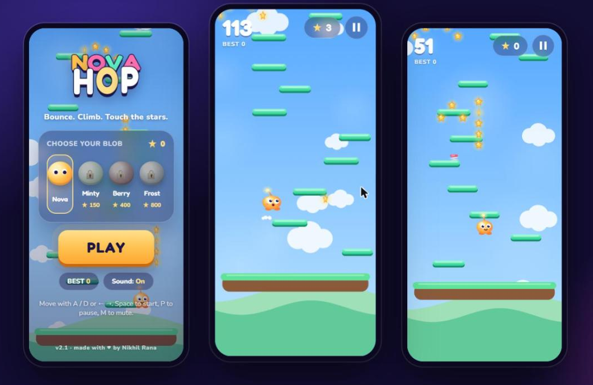
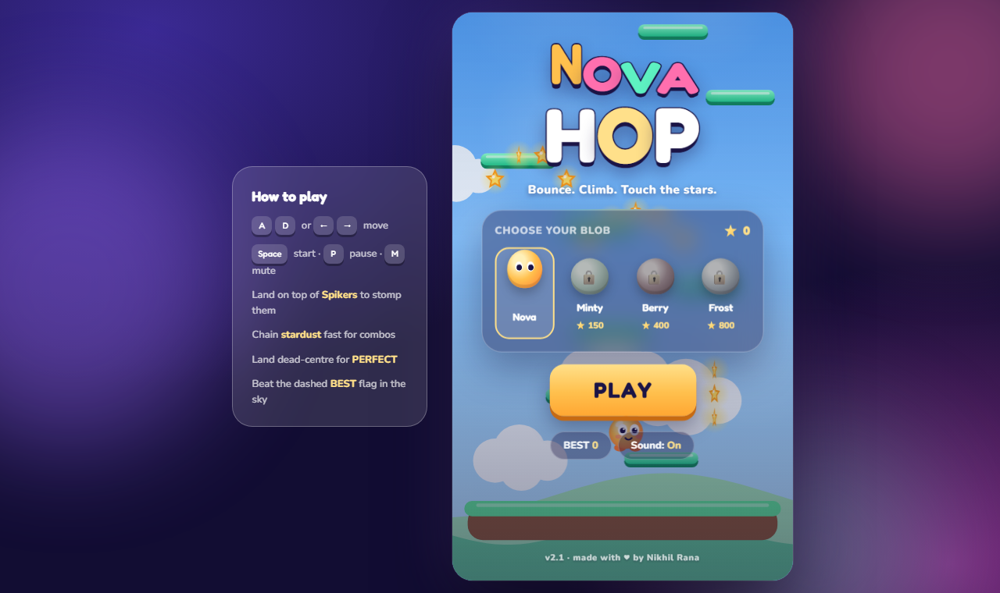

<div align="center">


# Nova Hop

### A bouncy sky-climbing arcade game that goes from cotton clouds to deep space.

**Bounce. Climb. Touch the stars.** Play in any browser, install it on Android or iPhone like a native app, and keep playing offline.


[▶️ **Play in browser**](https://nikhilrana2715.github.io/Doodle-Jump-website-Game/) · [📱 **Install on your phone**](#-install) · [🧩 **Run locally**](#-build-from-source)

[Features](#-features) · [Controls](#-controls) · [Install](#-install) · [Build from source](#-build-from-source) · [Deploy](#-deploy) · [Architecture](#-architecture) · [Design system](docs/DESIGN-SYSTEM.md) · [Roadmap](#-roadmap) · [FAQ](#-faq)



</div>

---

## ✨ Features

| | |
|---|---|
| 🟠 **Juicy jumping** | Squash-and-stretch blob, speed trails, landing dust, springy platforms, screen shake on big hits |
| 🎯 **Skill moments** | Land dead-centre for **PERFECT +5**, chain stardust for **COMBO ×5**, stomp **Spikers** from above for **+50** |
| 🚀 **Power-ups** | **Rocket** (blast through enemies) · **Shield** (survive one hit) · **Magnet** (pull in stardust) |
| 🧱 **Platform mix** | Solid · moving · cloud (one bounce, then poof) · crumbling decoys · springs |
| 🌌 **4 living zones** | Cotton Sky → Sunset Drift → Aurora Reach → Deep Cosmos, with blended skies, parallax clouds, twinkling stars and a ringed planet |
| 🏁 **Best-height flag** | A dashed **BEST** line in the sky shows exactly where your record is |
| 🎨 **Unlockable skins** | Nova, Minty, Berry, Frost, bought with the stardust you collect |
| 💬 **Popups everywhere** | BOING!, PERFECT, COMBO, STOMP, NEW BEST! with confetti, zone banners, an animated score count-up |
| 🔊 **Synth audio** | Every sound is generated live with the Web Audio API, so there are zero audio files to download |
| 📳 **Haptics** | Vibration feedback on Android (toggle in the menu) |
| 📤 **Share** | One tap shares your score (native share sheet or copy-link) |
| 🏆 **Leaderboard** | Optional Express + MongoDB global top-10; hidden automatically when there's no server |
| ♿ **Accessible** | Respects `prefers-reduced-motion`, keyboard-first, focus rings, safe-area aware on notched phones |

<div align="center">

</div>

## 🎮 Controls

| Action | Desktop | Phone / tablet |
|---|---|---|
| Move | <kbd>A</kbd> <kbd>D</kbd> or <kbd>←</kbd> <kbd>→</kbd> | Hold the left / right half of the screen, **or** switch to **Tilt** |
| Start / restart | <kbd>Space</kbd> / <kbd>Enter</kbd> | Tap **PLAY** |
| Pause | <kbd>P</kbd> / <kbd>Esc</kbd> | ⏸ button (also auto-pauses when you leave the app) |
| Mute | <kbd>M</kbd> | **Sound** pill in the menu |

Jumping is automatic. Your job is to steer, chain combos and survive.

## 📱 Install

Nova Hop is a **Progressive Web App**, so there's no app store needed.

- **Android (Chrome):** open the [game link](https://nikhilrana2715.github.io/Doodle-Jump-website-Game/), then tap **⋮ → Add to Home screen / Install app**. It launches fullscreen and works offline.
- **iPhone / iPad (Safari):** open the link, then tap **Share → Add to Home Screen**.
- **Desktop (Chrome / Edge):** click the install icon in the address bar.

## 🛠 Build from source

There's no bundler and no build step. It's plain HTML, CSS and JavaScript.

```bash
git clone https://github.com/nikhilrana2715/Doodle-Jump-website-Game.git
cd Doodle-Jump-website-Game

# Option A: static only (no leaderboard)
npm run static            # → http://localhost:8080
# or just open index.html in your browser

# Option B: with the global leaderboard (needs MongoDB)
npm install
npm start                 # → http://localhost:3000
```

| Env var | Default | Purpose |
|---|---|---|
| `PORT` | `3000` | Server port |
| `MONGO_URL` | `mongodb://localhost:27017/novahop` | Leaderboard database |

## 🚀 Deploy

- **GitHub Pages:** live at **https://nikhilrana2715.github.io/Doodle-Jump-website-Game/**, deployed from the `main` branch (root). Every push redeploys.
- **Any static host** (Vercel, Netlify, Cloudflare Pages): point it at the repo root. There's no build command and the output directory is `/`.
- **Leaderboard server:** any Node host (Render, Railway, Fly.io) running `npm start` with `MONGO_URL` set.

> When you change cached files, bump `CACHE` in `sw.js` so installed players get the update.

## 🧠 Architecture

```
index.html            DOM: canvas, HUD, menu / pause / game-over screens
css/style.css         Design tokens (color, type, space, radius) + components
js/game.js            Game engine: state machine, physics, generation, rendering, input
js/audio.js           window.Sfx: Web Audio synthesized sound effects
sw.js                 Service worker (network-first, offline fallback)
manifest.webmanifest  PWA metadata + icons (assets/)
sarver.js             Optional Express + MongoDB leaderboard API
docs/                 Screenshots + design-system guide
legacy/               The original v1 prototype (unused, kept for history)
```

- **Fixed 60 Hz timestep.** Physics feels identical on 60 Hz laptops and 120 Hz phones.
- **Resolution independent.** The world is always 400 units wide and its height follows the screen. It renders at device pixel ratio for crisp edges.
- **Always reachable.** Row gaps stay below the jump height, and crumbling platforms are only ever *extra* decoys.
- **Difficulty curve.** Gaps, platform width, moving/cloud odds and enemy density scale smoothly with altitude.
- **States:** `menu → play → dying → over`, plus `paused`.
- **Persistence:** `localStorage` (`novahop.*`) stores best score, best height, stardust wallet, owned skins and settings.

### API (optional server)

| Method | Route | Body / response |
|---|---|---|
| `GET` | `/api/leaderboard` | `[{ name, score, character }]` (top 10) |
| `POST` | `/api/submit-score` | `{ name ≤16 chars, score, character }` |

## 🗺 Roadmap

- [x] v2.0: full rebuild as Nova Hop with zones, power-ups, skins, PWA and synth audio
- [x] v2.1: best-height flag, share button, haptics toggle, tokenized design system
- [ ] Daily challenge seed (everyone plays the same tower)
- [ ] Achievements & missions
- [ ] More enemies (drifting UFO, bouncing jelly)
- [ ] Android APK via Trusted Web Activity

## ❓ FAQ

**Is this Doodle Jump?**
No. The project started as a learning clone, but v2 is a fully original game with its own name, character, art (all drawn in code) and sound. The original prototype lives in `legacy/` for history only.

**Does it need internet?**
Only the first load. After that the service worker caches everything, and the leaderboard is the only online feature.

**Why is the server file called `sarver.js`?**
It's a typo from v1 that stuck around, kept so existing scripts don't break.

**Tilt doesn't work on my iPhone.**
iOS asks for motion permission. Tap **Controls: Touch** in the menu to switch to Tilt, then allow the prompt.

---

<div align="center">

Made with ♥ by **Nikhil Rana** · Licensed under **ISC**

</div>
